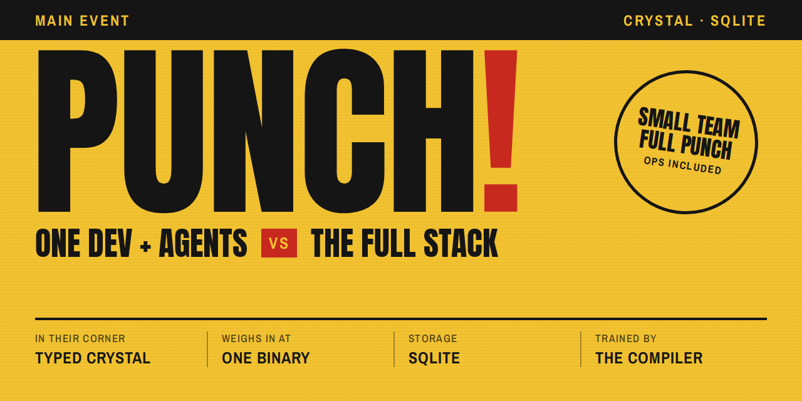

<p align="center">
  
</p>

# Punch

Small team, full punch: typed Crystal, SQLite, one binary, built for devs and their agents. Ops included.

Punch is a web framework for Crystal, for teams of one to about five who build business software and write much of their code with coding agents. An app deploys as one static binary and a few SQLite files on one machine. Jobs, backups, secrets, telemetry, and an ops console come with the framework.

**Punch is at version 0.1.** It is not released, its API may change between minor versions, and it has not yet had an independent security review.

## What an app looks like

An app is a set of typed operations: a Query reads, a Command writes. Each has a typed input and a typed set of outcomes.

```crystal
module Billing::Invoices
  @[Punch::Authorize(ByRole)]
  struct Show < Punch::Query
    struct Input
      include Punch::Input

      @[Punch::PathParam]
      getter invoice_id : ID
    end

    alias Output = Detail | NotFound

    def call(input : Input, db : Punch::Reader, _actor : Invoicing::Actor) : Output
      invoice = Store.load(db, input.invoice_id)
      invoice ? Store.detail(db, invoice, Time.utc) : NotFound.new
    end
  end
end
```

From that declaration, Punch serves three surfaces:

- **HTML for people:** a page beside the Query renders the invoice, with the buttons the viewer may use.
- **Markdown for agents:** the same page, asked for as markdown, describes the invoice and its actions.
- **JSON for programs:** the Query answers JSON, documented in an `openapi.json` derived from the types.

## What you get

- **The compiler as the first reviewer.** An operation without an access policy does not compile. Each error names your type, says why, gives the fix, and links the page that explains it, and those pages ship inside the app.
- **Accounts from the start.** `punch new` writes sign-up, sign-in, password reset, email verification, two-factor sign-in, API tokens, and deploy recipes.
- **One machine, a few files.** A static binary, four SQLite files, Litestream replicating to S3-compatible storage, and kamal-proxy or Caddy in front. No Redis, no database server, no separate job service, no Node toolchain.
- **Ops included.** Errors, traces, jobs, and performance live in the app's own SQLite files, and a built-in console and `punch ops` read them.
- **Deploys without dropped requests.** The new binary starts beside the old one and takes over when it is ready.

## What it is not for

Punch runs on one node: no read replicas, no multi-writer database, no automatic failover. SQLite is its only database, and it needs a persistent local disk. Pages are server-rendered HTML with Turbo, so it does not suit single-page apps with a Node toolchain. Crystal's library ecosystem is small.

## Start here

1. [Introduction](docs/guides/introduction.md): whether Punch fits your project.
2. [Installing Punch](docs/guides/installing.md): the `punch` tool and the Crystal compiler.
3. [Getting Started](docs/guides/getting-started.md): a first app, from `punch new` to a passing `punch check`.

Then [all the documentation](docs/README.md), or [`reference/`](reference/), the reference app. Working on Punch itself? Read [`AGENTS.md`](AGENTS.md).

## License

MIT. See [LICENSE](LICENSE).
